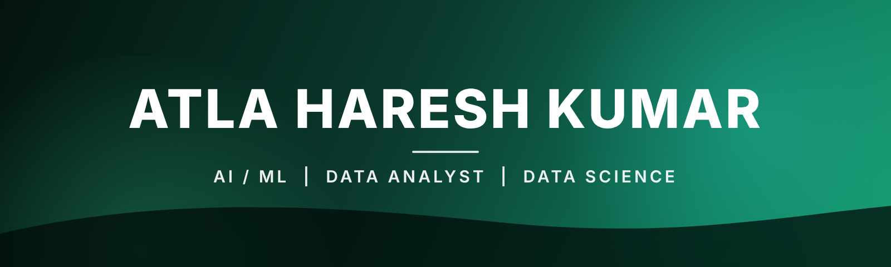

  

Computer Science graduate from Hyderabad who enjoys turning data into insights and building practical AI applications.

---

## 🚀 About me
- 🎓 B.Tech graduate in Computer Science & Engineering (Specialization in Internet Of Things) from     Malla Reddy University, Hyderabad.
- 💻 Interested in Data Science, Data Analysis, Machine Learning and Artificial Intelligence.
- 🧠 Hands-on experience building machine learning and AI-based projects.
- 📊 Interested in data analysis, predictive analytics and data visualization.
- 🤖 Exploring Generative AI, LLMs, RAG, AI Agents and LLM Guardrails.
- 🌱 Continuously learning and improving my technical skills.
- 🎯 Seeking entry-level opportunities in Data Science, Machine Learning and AI.

## 🛠️ Technical skills

### Programming Languages

### Data Science & Analytics

### Machine Learning & AI

### Frameworks, Databases & Tools

## 💡 Featured projects

### 1. PDF Question Answering Chatbot (RAG)
Ask questions about a PDF and get answers with page-number sources. It replies "I don't know" when the answer is not in the document.
**Tech:** Python, LangChain, FAISS, Hugging Face, Gemini API, Streamlit
🔗 [Repository](https://github.com/Haresh-reddy/RAG-PDF-QA-Chatbot) 

### 2. Crime Data Analysis and Prediction System
Cleaned district-wise Indian IPC crime data and trained a multi-output Random Forest model that reached an R² of about 0.71 on the test set, with a Tkinter interface.
**Tech:** Python, Pandas, NumPy, Scikit-learn, Tkinter
🔗 [Repository](https://github.com/Haresh-reddy/Crime-Data-Analysis)

### 3. LLM Guardrails
Input and output checks around the Gemini API to block unsafe prompts and validate responses.
**Tech:** Python, Google Gemini API, LLMs
🔗 [Repository](https://github.com/Haresh-reddy/LLM-Guardrails)

### 4. IoT-Based Drinking Water Quality Monitoring System
Real-time water quality monitor using an ESP32 and pH, turbidity, temperature and TDS sensors, with remote monitoring and threshold alerts on Blynk Cloud.
**Tech:** ESP32, Sensors, Blynk Cloud
🔗 [Repository](https://github.com/Haresh-reddy/IoT-Based-Drinking-Water-Quality-Monitoring-System)

## 🌐 Connect with me

⭐ Thanks for visiting my profile! Let's connect and build something useful with data and AI.

